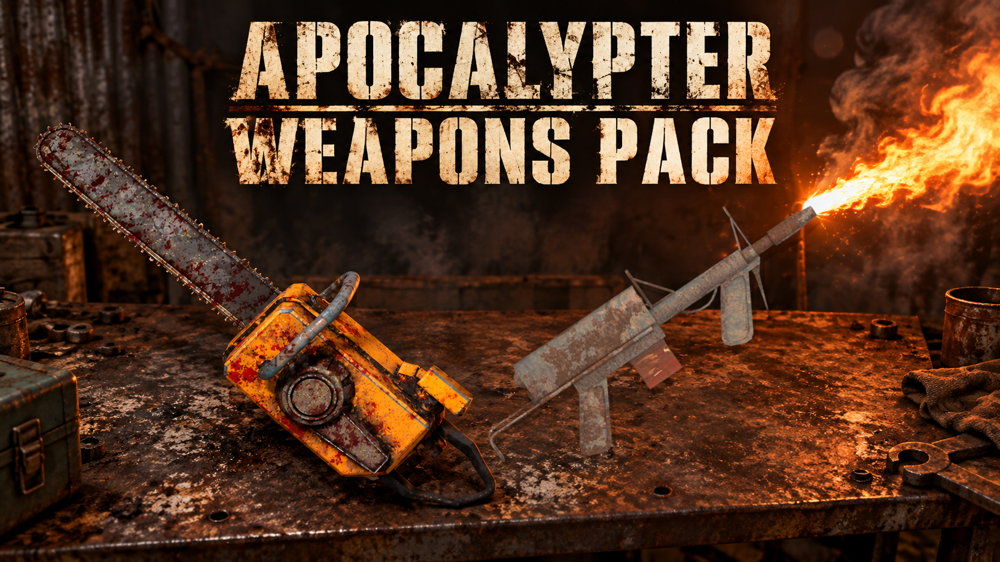

# Apocalypter Weapons Pack 1.6.1

Adds a gasoline-powered chainsaw and a refillable flamethrower with their own models, inventory images, Codex entries, fuel tanks and saved item identities.

## Installation

Requires BepInEx 5 for the game. Close Apocalypter, then extract this archive into the game folder so that `BepInEx/plugins/Apocalypter Weapons Pack` contains the DLL and its asset folders.

Keep your existing `BepInEx/config` files when updating. Install only one copy of Apocalypter Weapons Pack.

The pack includes its holding and attack profiles. It installs them only when their corresponding config files are missing. The placement adjuster, animation editor and Inspector are optional separate mods. Apocasetter is optional for the in-game settings panel; without it, edit `BepInEx/config/apocalypter.weaponspack.cfg` while the game is closed.

## Finding the weapons

- Chainsaw: 25% chance in each Buzzgut and Black Juggernaut boss area.
- Flamethrower: 25% chance at each Professor location and underground Laboratory.
- Slumtown weapons merchant: an independent 10% chance of stocking each weapon, at a random price of 3,000–4,000 nuts each. Use the normal Buy interaction. The same merchant can request either weapon for 2,000–3,000 nuts, using the normal delivery/sale confirmation. Requests roll independently at 10% each when its native request board refreshes.

Each location/shop rolls once for its generated stock. Visiting again, purchasing an item or reloading does not reroll it. Both successful and unsuccessful rolls are saved. Existing saves can receive rolls at locations without a previous pack record. Previously generated test loot is retained.

## Controls and fuel

- Chainsaw: LMB swings; hold RMB for continuous sawing. Both attacks consume gasoline, including misses, and use the last fraction of fuel.
- Flamethrower: hold LMB to fire; use the game's Aim Down Sights input and Hold/Toggle preference to aim.
- Refill the dropped weapon by pouring an appropriate can into its tank using normal game pouring. Both tanks hold 5 L.
- The chainsaw accepts gasoline. The flamethrower accepts gasoline, diesel or engine oil, one type at a time. Empty the tank before changing fuels.

Gasoline provides the shortest flame range and lowest damage, diesel is intermediate, and engine oil has the longest range and highest damage. The current fuel, damage and range appear on the weapon tooltip. Fuel counters and empty-tank audio show when a refill is needed.

The flame stream arcs down slightly and can damage several enemies across its width. Solid cover stops it. Direct flame contact heats native explosive fuel containers before ignition. Scorch marks fade within five seconds; brief surface fire shrinks and fades. Muzzle glow, smoke, light, recoil and stove ignition/burner sounds accompany firing.

## Settings

Damage, range, fuel cost and attack rate are adjustable. Flamethrower settings are separate for each fuel. Fuel consumption per second equals fuel cost per attack multiplied by attack rate. Flame damage per second stays independent of attack rate. Spawn chances and visual settings are fixed in this release.

Player-facing balance settings use one decimal place, including fuel costs (0.1/0.2/0.3 L; minimum 0.1 L). Actual tank contents and continuous draining retain full precision. Existing saved values and new edits round to that precision. Flamethrower range defaults are exactly 5 m for gasoline, 7 m for diesel and 10 m for engine oil; chainsaw LMB defaults to 0.8 swings per second. Authored holding and animation profiles are unaffected.

## Release changes

1.6.1 fixes inactive merchant request metadata and restores Apocasetter's standard scaled settings and detail tabs. The specific Apocapocket save-start failure has been reproduced and regression-tested; full gameplay and 4K checks are still outstanding. See [testing](docs/TESTING.md).

1.6.0 removes the spawn testing controls and new test-site creation, sets flamethrower world rarity to 25%, adds Slumtown merchant stock, and uses the branded runtime folder. Saves made with old test sites retain the minimum geometry restoration needed to support their saved items. Existing holding profiles, authored chainsaw animations, fuel settings and stock M16 assets are retained.

The download contains runtime files and required profiles. Personal backups, source, editors, diagnostic captures, caches and debug symbols are excluded.

Download the installable ZIP from this repository's Releases page.

## Source and development

The public source builds the chainsaw and flamethrower. See [building](docs/BUILDING.md), [testing](docs/TESTING.md), [publishing](docs/PUBLISHING.md), [folder layout](docs/LAYOUT.md), and [credits](CREDITS.md). Unreleased local weapon work is kept outside this repository.
